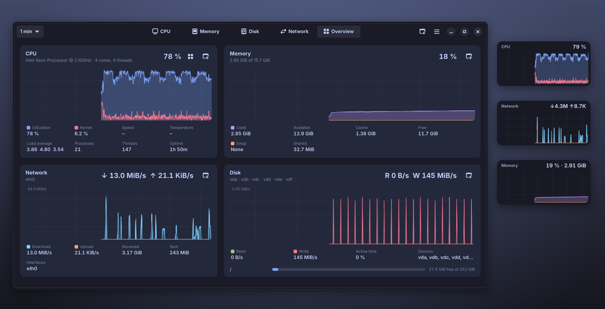
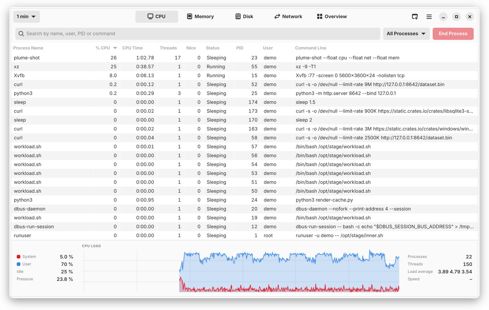
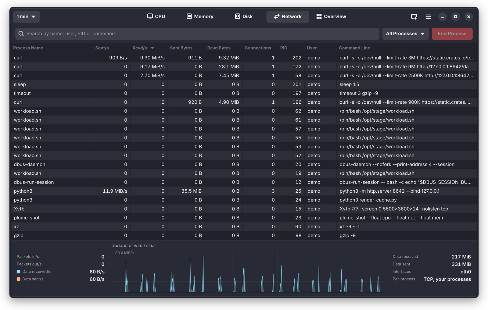
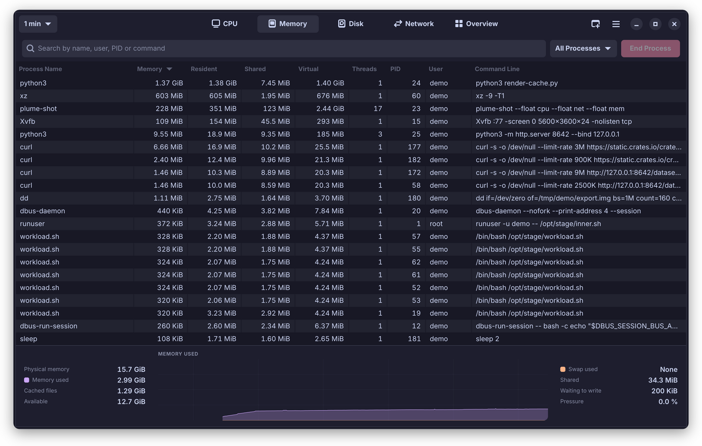
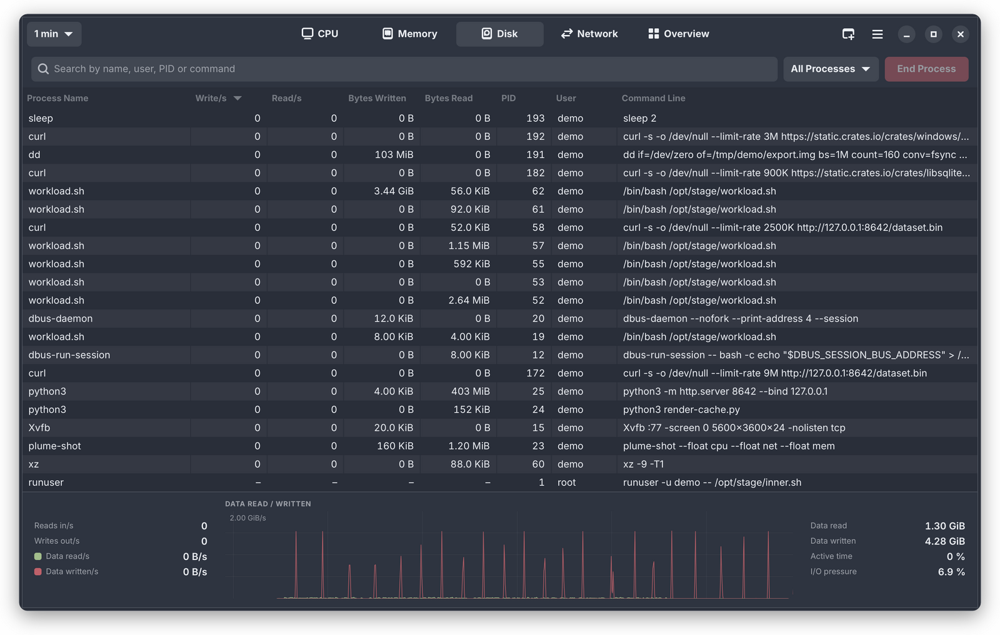
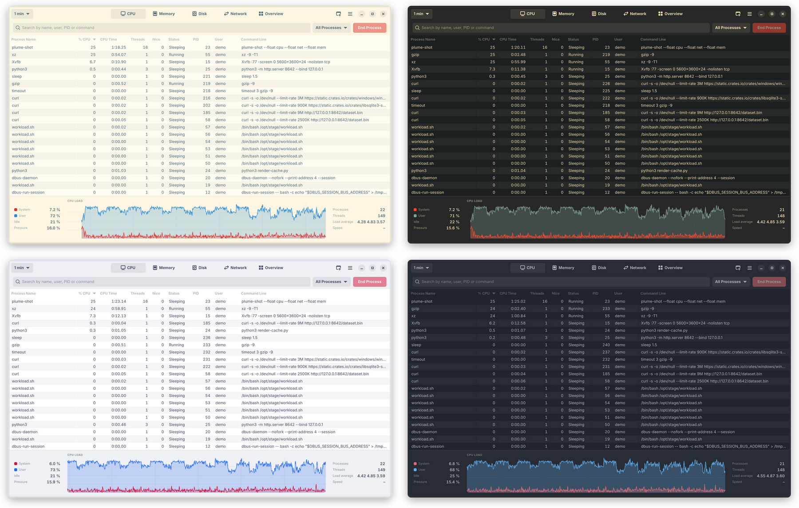
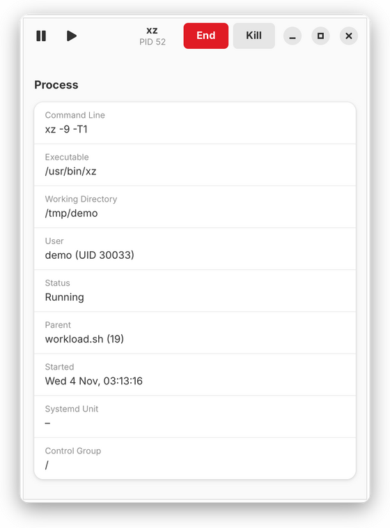
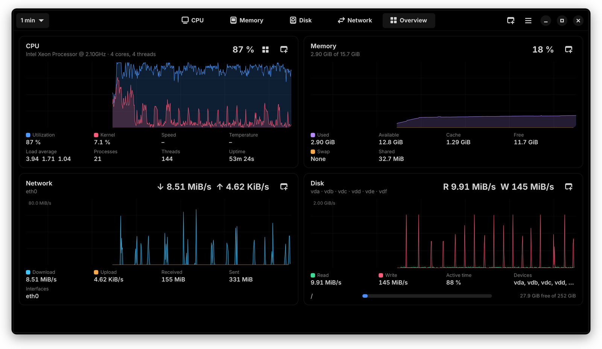
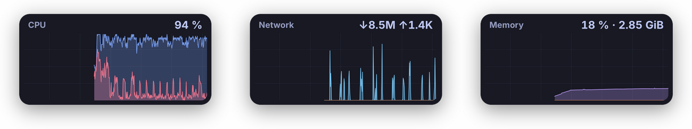

<div align="center">


# Plume

**A featherweight system monitor for GNOME, with graphs that move at your display's frame rate.**

[](https://github.com/feederbrian/plume/releases/latest)
[](LICENSE)
[](https://gtk-rs.org)
[](#install)

[Install](#install) · [Features](#features) · [Floating readouts](#floating-readouts) · [Shortcuts](#keyboard-and-mouse) · [How it stays light](docs/DESIGN.md)

<br>



</div>

## Features

- **Per-process tabs, like Activity Monitor.** CPU, Memory, Disk and Network each show the process list with the columns that matter for that resource, plus a live summary panel. Search, filter and selection carry across tabs.
- **Smooth, sharp, live graphs.** A tiny GPU shader draws each graph from a few hundred bytes of new data per sample, shading only the area under the curves, and redraws only when the graph has moved a pixel. Lines are exactly as thin as you set them and glide without stutter.
- **Any time scale.** From 30 seconds to 1 hour, set in the header bar, with Ctrl+scroll over any graph, or separately for each floating readout.
- **Floating readouts.** Pop any graph out into a small always-on-top window, macOS-style. Resize it from its bottom-right corner.
- **An Overview you arrange.** CPU, memory, every GPU, network and disks on one page. Drag a card by its header to put it where you want it.
- **Laptop-friendly GPU monitoring.** Intel, NVIDIA and AMD, with real engine utilisation and a per-process **% GPU** column. A sleeping discrete GPU is never woken up just to be measured.
- **Process control.** End, kill, stop, continue and re-prioritise, with protection against acting on a recycled PID, and an administrator prompt for other users' processes.
- **An inspector for every process.** Command line, executable, working directory, systemd unit, memory breakdown, I/O, network, open files, context switches.
- **Sixteen themes, OLED included.** Follows GNOME's light/dark setting, or pick OLED Black, Tokyo Night, Solarized, Nord, Gruvbox, Dracula, Catppuccin, One Dark and more. A **pure black** switch makes any dark theme OLED-friendly.

## A look around

<table>
  <tr>
    <td width="50%"><br><sub><b>CPU</b>: per-process CPU and CPU time, with system/user split and CPU pressure. <i>Adwaita</i></sub></td>
    <td width="50%"><br><sub><b>Network</b>: per-process send/receive rates, totals and connections. <i>Dracula</i></sub></td>
  </tr>
  <tr>
    <td width="50%"><br><sub><b>Memory</b>: private, resident, shared and virtual memory, with memory pressure. <i>Catppuccin Mocha</i></sub></td>
    <td width="50%"><br><sub><b>Disk</b>: per-process read/write rates and lifetime totals, with IOPS and I/O pressure. <i>Nord</i></sub></td>
  </tr>
</table>

<table>
  <tr>
    <td width="66%"><br><sub>Solarized Light, Gruvbox Dark, Catppuccin Latte and One Dark.</sub></td>
    <td width="34%"><br><sub>The process inspector updates live.</sub></td>
  </tr>
</table>

### OLED



**OLED Black** leaves unused pixels off: pure black surfaces, softened text (pure white blooms on OLED) and hairline borders instead of shadows. Prefer another palette? Turn on **Preferences → Appearance → Pure black backgrounds** to get it on true black.

## Install

Download the latest `.deb` from [**Releases**](https://github.com/feederbrian/plume/releases/latest), then:

```bash
sudo apt install ./plume_0.2.2_amd64.deb
```

Plume appears in your applications as **Plume**. It needs Ubuntu 24.04 or newer (GTK ≥ 4.14, libadwaita ≥ 1.5) and runs on X11 or Wayland.

## Floating readouts



Click the pop-out button on any graph, or use the window button in the header bar. Drag a readout anywhere, and drag its bottom-right corner to resize it; each readout remembers its size. Right-click it for opacity, time scale or closing (and, on the CPU readout, every logical CPU); scroll over it to change its time scale; double-click to open the main window; press Esc to close it.

On GNOME's Wayland session, apps can't keep their own windows above others. That's a deliberate compositor policy. The bundled **Plume Floats** shell extension does it for Plume's readouts only, puts them on every workspace and remembers where you left them. Enable it once, after logging out and back in following installation:

```bash
gnome-extensions enable plume-floats@feederbrian.github.io
```

Without the extension, readouts behave like normal windows, and Alt+Space → **Always on Top** still works.

Readouts can also be opened from the command line, for example at login:

```bash
plume --background --float cpu --float gpu1 --float net
```

IDs: `cpu`, `cores`, `mem`, `gpu0`, `gpu1`, `net`, `disk`. Running `plume` again talks to the instance that's already open.

## Keyboard and mouse

| | |
|---|---|
| <kbd>Ctrl</kbd>+<kbd>1</kbd> … <kbd>Ctrl</kbd>+<kbd>5</kbd> | CPU, Memory, Disk, Network, Overview |
| <kbd>Ctrl</kbd>+<kbd>F</kbd> | Search processes |
| <kbd>Delete</kbd> / <kbd>Shift</kbd>+<kbd>Delete</kbd> | End / kill the selected process |
| <kbd>Ctrl</kbd>+<kbd>S</kbd> / <kbd>Ctrl</kbd>+<kbd>C</kbd> | Stop / continue the selected process |
| <kbd>Enter</kbd>, double-click, <kbd>Ctrl</kbd>+<kbd>I</kbd> | Open the process inspector |
| Right-click a process | Actions and priority |
| Drag a card's header (Overview) | Reorder the cards |
| Drag a readout's bottom-right corner | Resize the readout |
| <kbd>Ctrl</kbd>+scroll on a graph, <kbd>Ctrl</kbd>+<kbd>−</kbd> / <kbd>Ctrl</kbd>+<kbd>=</kbd> | Longer / shorter time scale |
| <kbd>Ctrl</kbd>+<kbd>,</kbd> | Preferences: theme, line width, frame rates, sampling, time scale |

## Hardware support

| | What Plume reads | Needs root? |
|---|---|---|
| **CPU** | Usage per logical core, kernel/user split, frequency, package temperature, pressure (PSI) | No |
| **Intel graphics** (i915, xe) | Engine utilisation and per-process GPU (DRM fdinfo), time awake (RC6), frequency | No |
| **NVIDIA** | Utilisation, VRAM, temperature, power and clocks via NVML. Polled only while the GPU is awake | No |
| **AMD** | `gpu_busy_percent`, per-process GPU (DRM fdinfo), VRAM and sensors | No |
| **Disks** | Throughput, IOPS and active time for physical disks; filesystem usage | No |
| **Network** | Interface throughput and packets; per-process TCP traffic | No (other users' processes: root) |

## Known limitations

- Per-process network figures cover **TCP connections**. UDP traffic, including QUIC/HTTP3, which browsers use heavily, isn't attributed to processes. Interface totals are always complete.
- Per-process GPU figures come from DRM accounting, so they cover Intel and AMD GPUs and your own processes. The NVIDIA driver doesn't expose them this way.
- Development happens largely in a VM without a GPU. Reports from real hardware are very welcome; please [open an issue](https://github.com/feederbrian/plume/issues) and include the output of `plume --bench` (run with Plume closed). It measures the renderer's GPU and CPU cost on your machine in about two minutes. `PLUME_PROFILE=1 plume` adds frame-pacing numbers.

## Build from source

You need Rust 1.92 or newer (from [rustup](https://rustup.rs); Ubuntu's packaged `cargo` is too old) and the GTK development headers:

```bash
sudo apt install build-essential pkg-config libgtk-4-dev libadwaita-1-dev
```

```bash
cargo run --release -p plume
```

```bash
cargo test --release
```

```bash
./packaging/build-deb.sh
```

`cargo run` starts Plume, `cargo test` runs the 40 tests (including a live TCP attribution test), and the packaging script builds `plume_<version>_amd64.deb`. [docs/DESIGN.md](docs/DESIGN.md) covers the architecture, the performance decisions and the measurements.

## License

[GPL-3.0-or-later](LICENSE). Plume was inspired by btop++, htop, nvtop, GNOME System Monitor and macOS Activity Monitor; it shares their ideas but not their code.
