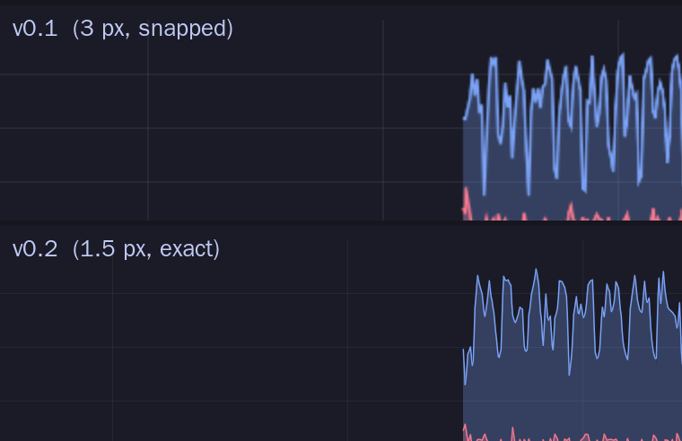

# How Plume stays light

Plume's brief was a process manager with live 60 fps graphs that uses almost
no CPU or memory. This document explains the decisions behind that, and what
was measured.

## A fresh codebase, not a fork

btop++ and htop were the obvious starting points. Both are terminal programs,
and their data collection is tangled with their drawing code: btop's Linux
collector is one 3,600-line file wired into its config and update loop in over
50 places. A fork would mean carrying a terminal UI we'd delete and rebasing
against upstream forever. Running a terminal program and reading its screen
from a GUI is slower and more fragile than reading `/proc` and `/sys` directly.

The data side turned out to be a few thousand lines of careful parsing. Plume
borrows ideas, not code:

* **btop++** (Apache-2.0): loading NVML with `dlopen`, the AMD sysfs layout,
  the overall shape of the collectors.
* **htop** (GPL-2.0+): opening each process's files relative to one handle on
  `/proc`, and only reading what the visible columns need.

GPL-3.0-or-later keeps code from btop, htop, nvtop and Resources legally
reusable later (for example nvtop's per-process GPU code).

## Layout

```
crates/plume-core   data collection, no GTK dependency
  cpu, mem, net, disk     /proc readers: files kept open, re-read with pread, no allocation per sample
  proc                    process scan: raw getdents64, files opened relative to /proc
  netproc                 per-process TCP traffic via NETLINK_SOCK_DIAG + /proc/<pid>/fd
  gpu/{intel,nvidia,amd}  GPU support, gated on the device's runtime power state
  actions                 signals through a pidfd with a PID-reuse check; renice of every thread
  history                 two-tier ring buffers: 10 Hz for ~5 min, 1 s means for 1 h
  sampler                 two threads (fast 10 Hz, slow 4 Hz), driven by what's on screen
crates/plume        GTK 4 / libadwaita app
  widgets/graph           the graph widget (below); widgets/gl: GL loader + shader;
                          widgets/columns: per-pixel column data; widgets/tiles: stable layout
  profile                 PLUME_PROFILE frame-pacing profiler
  pages/processes         CPU / Memory / Disk / Network tabs
  pages/summary           bottom summary panels
  pages/resources         Overview dashboard: GPUs, per-core grid, filesystems
  floats, inspector, prefs, theme, settings
extension/          GNOME Shell extension for floating readouts
packaging/          build-deb.sh
```

## Sampling vs. drawing

The kernel counts CPU time in 10 ms steps. Sampled 60 times a second, a single
core would jump between 0 %, 60 % and 100 % from rounding alone. So Plume
samples at 10 Hz (adjustable) and draws at the display's frame rate. Graphs run
one sample interval behind real time, so there is always real data at the live
edge and the scroll never waits for a sample.

## The graph renderer

Rebuilding and rasterising curves every frame is what made GNOME System
Monitor's smooth graphs expensive. Plume's first renderer avoided that by
rendering each curve into a texture once per sample and sliding it every frame.
On a 4K laptop that still meant ten ~6 MB off-screen renders per graph per
second, all landing in the same frame, and they could stall the UI thread.
0.2 replaces it with a shader:

1. **Columns.** History is reduced to one value per *device-pixel column*
   (`widgets/columns.rs`): interpolated between samples on short time scales,
   the column maximum on long ones so spikes never vanish, the newest value
   held at the live edge. Columns live in a ring texture (RGBA32F, 2 rows:
   values, plus per-column min/max envelopes). A new sample recomputes and
   uploads only the few dozen columns it touches.
2. **One draw per frame.** A `GtkGLArea` per graph runs one fragment shader
   (`widgets/gl.rs`) over a full-screen triangle. The scroll position is a
   uniform, so each pixel knows its exact sub-pixel data coordinate. Fill
   coverage comes from the signed distance to the curve, line coverage from
   the distance to the five nearby segments. Lines are exactly `line_px`
   device pixels wide at any scroll offset: even motion, no resampling blur.
3. **Early outs.** The envelope row lets most pixels decide with a single
   texel fetch whether they're above the curve (draw nothing), deep inside the
   fill (flat colour) or near the line (exact test).
4. **Frame skipping.** A graph only re-renders when it moved at least a
   quarter pixel, its data or axis changed, or the theme changed. The focused
   window runs at up to 60 fps; floating readouts and background windows at 30.
5. **One context per window.** All graphs in a window share a GL context
   (each still renders into its own framebuffer), because a context per graph
   costs several MB. With a shared context the GL viewport is shared state, so
   each draw sets its own from the area's tracked framebuffer size.



GL entry points come from libepoxy's dispatch pointers (GTK already loads it),
so there's no extra dependency, and the same shader body compiles as GLSL 3.30
core or GLSL ES 3.00. Without OpenGL, the old GskPath-to-texture renderer is
used automatically. `PLUME_GRAPH=gsk` forces it, for comparison.

## Only do what's on screen

* Graphs re-render only when they visibly change (see above), at up to 60 fps
  in the focused window and 30 fps elsewhere. Every frame keeps the GPU awake
  for a moment, so frame count matters for battery more than per-frame cost.
* The process scan runs only while a process tab or an inspector is open.
* `/proc/<pid>/io` (one extra file per process) is read only on the Disk tab.
* Socket attribution runs only on the Network tab.
* Graph tick callbacks exist only while the graph is mapped, and GTK stops
  sending frames to hidden, minimised or suspended windows. With nothing
  visible, sampling drops to 1 Hz.
* Sampler threads raise their timer slack (1 ms / 5 ms) so the kernel can
  batch their wake-ups with other timers.

## The process list

The list holds N row objects that never move. Row *i* shows whichever process
is currently *i*-th in sort order. The selection follows the process, and a
recycled PID is never mistaken for the process you selected: actions check
`(pid, start time)` through a pidfd.

GTK keeps about 200 rows bound, far more than are visible. When a busy process
moves up one rank, every row below it changes content. Notifying all bound
cells cost 65 ms per refresh with 300 processes, so only rows in (or near) the
viewport are notified. Off-screen rows are marked stale and flushed when
scrolling brings them into view. Tooltips are produced on hover rather than
rebuilt on every update; that alone was most of the per-cell cost.

Alternating row colours are tagged by item position, which is stable in this
model, on the cell labels. Changing CSS on GTK's own row widgets during bind
trips an assertion in GTK 4.14's list widget.

## Layout stability

Values update four times a second. A layout that depends on text width (such
as GtkFlowBox) can then resize or move cards, and any resize changes a graph's
width and therefore its time scale, which looks like jitter. So the Overview
uses a container that picks one or two *equal* columns from the available
width only (`widgets/tiles.rs`). Every value label has a fixed width with
tabular digits, and stats sit in a fixed 4-column grid. `PLUME_PROFILE=1`
counts graph resizes, which should stay at 0.

Cards are reordered by dragging their headers, and the same rule applies:
nothing moves until the drop. The container dims the dragged card and
places a single outline widget over the slot under the pointer, so a drag
costs one re-allocation per slot change and never resizes a graph. On
release the cards are reordered once, and the order is saved by card id.

## Floating readouts

Readouts are undecorated windows, so they have no resize borders. An
invisible 16 px grip in the bottom-right corner calls
`gdk_toplevel_begin_resize` (`xdg_toplevel.resize` on Wayland). The
compositor runs the resize, so it is as smooth as any window's. GtkWindow
clips hit-testing to its rounded corners, which would leave the very corner
dead, so readouts turn that clipping off; nothing inside them reaches the
corners. A resize reports a new size every frame, so the size is saved half
a second after the last change.

## GPUs

* **NVIDIA (Optimus / RTD3):** any NVML query keeps a sleeping dGPU awake. Plume
  reads `power/runtime_status` first, which is free and never wakes the device,
  and connects to NVML only when the GPU is already awake. It disconnects after
  3 s at 0 % with no GPU processes, so the GPU can power down again. "Asleep"
  in the UI means the GPU is powered down.
* **Intel:** the kernel's per-client DRM accounting (`/proc/<pid>/fdinfo`, as
  used by intel_gpu_top and nvtop) gives real engine time without root, at
  least for the user's own processes, the compositor included. Plume finds DRM
  file descriptors incrementally (new processes once, known GPU clients every
  5 s, others every 30 s, within a 2 ms budget), sums engine-time deltas per
  engine class, and shows the busiest class as utilisation, plus a per-process
  "% GPU" column. It also still reports `1 − ΔRC6 / Δt` from the RC6 residency
  counter as "Awake". That is time the GPU spends out of its sleep state;
  frequent tiny workloads such as 60 fps animation keep it high, so it reads
  far above engine utilisation (60–70% awake can mean single-digit busy).
* **AMD:** `gpu_busy_percent`, VRAM and hwmon sensors, also gated on runtime PM.

## Per-process network

Linux has no per-process byte counters. Plume dumps every TCP connection's
`bytes_acked` / `bytes_received` through `NETLINK_SOCK_DIAG` (no privileges
needed), maps connections to processes via the `socket:[inode]` links in
`/proc/<pid>/fd`, caches the result, and walks fd tables only for new
connections, at most 4 ms per scan. UDP (including QUIC / HTTP3) is not
attributed, and other users' processes need root. An eBPF helper would close
that gap.

Kernel counters measure what reaches the machine, not what an application has
read yet. A rate-limited download can briefly show more than its limit while
the socket buffer fills.

## Measurements

Taken in a 4-vCPU cloud VM at 2× scale. This VM has no GPU: Mesa's llvmpipe
runs all GPU work, including the graph shader and GTK's compositing, on the
CPU. CPU-side numbers are real; anything labelled "paint" is inflated.

### 0.2 profiling pass (`PLUME_PROFILE=1`)

| | 0.1 | 0.2 |
|---|---|---|
| Overview: work per new sample, per graph | 2.7–3.5 ms (path build, render, upload) | 7–10 µs (column update) |
| Overview: data uploaded to the GPU | several MB/s of textures | 22 KiB/s |
| Overview: layout phase, p95 / max | 13–19 ms | 0.67 / 1.3 ms |
| Overview: graph resizes while values change | frequent (content-sized cards) | 0 |
| CPU tab, 314 processes: list refresh avg / max | 34–60 / 89–213 ms | 0.7–1.1 / 1.1–1.5 ms |
| CPU tab: first open of a tab | 110–166 ms | 50 ms |
| Three floating readouts: graph code | 9.3% of a core | 0.65% |
| Memory with 10 graphs: one context per graph vs per window | — | −65 MB |

The graph shader ran 2,700 µs → 590 µs per draw on llvmpipe after
specialising it for two series. On a GPU each draw is a few microseconds of
CPU time.

### Collector

| | cost |
|---|---|
| CPU / memory / network / disk sample | 5.6 / 3.8 / 3.6 / 7.6 µs |
| Process scan, 482 processes | 3.9 ms (≈ 0.4 % of a core at 1 Hz) |
| Whole sampler, 10 Hz + process scan at 1 Hz | 0.8 % of one core, 4.3 MB RSS |
| Empty libadwaita window (`examples/baseline.rs`) | 116 MB RSS (Cairo) / 176 MB (llvmpipe) |

Most of the memory figure is GTK, libadwaita and the GL driver. Measure your
own machine:

```bash
PLUME_PROFILE=1 plume                                 # frame pacing + graph cost, every 5 s
cargo run --release -p plume-core --example bench     # collector cost per sample
```

## Screenshots

The README screenshots come from a real workload (xz/gzip compression, a local
HTTP server and downloads, `dd` writes, a 1.4 GiB working set). It ran as an
unprivileged user in private PID and mount namespaces, so only that workload is
visible. The VM has no GPU, so no GPU cards appear.
